  

<h3 align="center">
  
</h3>

---

### 🚀 About Me

- 💻 Software Engineer
- 🔭 Currently exploring the AI domain broadly
- 🎯 2026 goal: transition into an AI Engineering role
- ✍️ I write about what I build on [Medium](https://medium.com/@ranhindavibhashana)
- 🏆 I sharpen my problem-solving on [HackerRank](https://www.hackerrank.com/vibhashana)
- 📫 Let's connect — details below!

---

### 🛠️ Tech Stack

  

---

### 💼 Experience

- <b>Software Engineer @ IFS R&D | Energy & Resources</b> (1+ yrs, Current)

- <b>Undergraduate Trainee Software Engineer @ IFS R&D | Supply Chain</b> (1 yr, Internship)

---

### 📊 GitHub Stats

  
  

  

  

  

  

---

### 🤝 Open to

- 🤝 Collaborating on open-source projects
- 💬 Discussing AI & system design / architecture
- 🕒 Part-time work

---

### 😇 Connect with Me

  <!--  -->
  
  
  <!-- 
  
   -->

  

